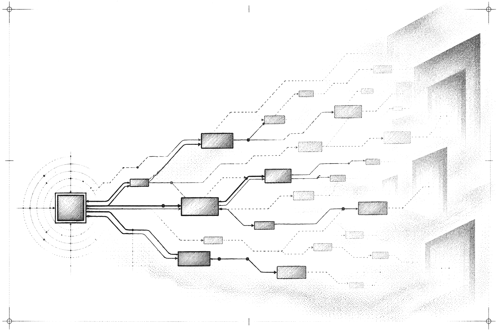

# Ghost Portal Cartographer

**Evidence-Tiered Mapping of Indirect Sensitive-Data Egress**

**Research author:** Thor Thor
**ORCID:** [0009-0001-6573-385X](https://orcid.org/0009-0001-6573-385X)
**GitHub:** [codethor0/ghost-portal-cartographer](https://github.com/codethor0/ghost-portal-cartographer)
**Research paper:** [Read the paper (PDF)](GPC_Research_Paper.pdf) | [LaTeX source](GPC_Research_Paper.tex)
**Zenodo DOI:** [10.5281/zenodo.24267416](https://doi.org/10.5281/zenodo.24267416) (v1.0.0; all versions: [10.5281/zenodo.24267415](https://doi.org/10.5281/zenodo.24267415))

<p align="center">
  
</p>
<p align="center"><em>Conceptual illustration of candidate artifact routes across an observation boundary. Not an empirical flow trace; also shown below the abstract of the paper.</em></p>

## Abstract

Sensitive information can cross a security boundary through logs, traces, memory artifacts, caches, backups, and integrations even when the primary application response is protected. Ghost Portal Cartographer (GPC) analyzes these indirect routes as a finite, declared artifact-version graph without inspecting payload contents. Three independently bounded searches distinguish reported scalar-ordered lineage, reported lineage with unresolved order, and possible data or unknown-content reachability. A positive witness survives resource exhaustion in another search, and the selected witness is labeled by the strongest relation it satisfies. Trace parentage remains unauthenticated context, not proof of transferred data. A local HMAC demonstration authenticates declared transformation metadata, bound to the artifacts and trust domains it describes, under a test policy; it cannot establish sanitization or exclude a candidate route. The standard-library implementation was evaluated on synthetic graphs using 171 tests, two separately coded graph oracles, exhaustive small-graph cases, randomized comparisons, and eleven detected deliberate mutations. These results support graph-relative search properties under stated assumptions; they do not establish verified exfiltration, complete observation, formal verification, or production readiness.

## Execute the research artifact

Python 3.9+; no external Python dependencies.

```sh
sh RUN_AUDIT.sh
```

`RUN_AUDIT.sh` verifies `SOURCE_HASHES.sha256`, then runs the unit tests, the synthetic demo, the deliberate mutants and the synthetic benchmark. Individual entry points:

```sh
python3 -m unittest -v test_gpc.py
python3 run_demo.py
python3 mutation_check.py
python3 benchmark.py
```

The package includes **171 regression tests**, two separately coded graph oracles (same author, same predicates), exhaustive enumeration of 512 possible-edge graphs and 625 observation mappings, and **eleven deliberate mutants**, all detected. These results do not constitute formal verification or real-world detection accuracy.

## What the kernel decides

For a query (source artifact, category, destination trust domain), GPC derives three nested edge relations, `E_O ⊆ E_R ⊆ E_P`, and runs three independently budgeted searches:

| Status | Meaning |
|---|---|
| `REPORTED_ORDERED_LINEAGE` | The selected reference-backed reported witness has strictly increasing declared sequences. |
| `REPORTED_ORDER_UNRESOLVED` | A reported witness exists but itself fails strict order; no ordered witness was returned. |
| `POSSIBLE_ROUTE` | A data or unknown-content path exists in the supplied graph. |
| `NO_ROUTE_IN_DECLARED_GRAPH` | The possible search finished without a witness; by containment no narrower route exists. |
| `UNKNOWN_LIMIT` | No witness and the possible search was capped. Withhold negative conclusions. |

## Model boundaries

- Reported edges are declarations, not authenticated evidence of real-world movement.
- Neither trace parentage nor scalar sequence constitutes verified distributed causality.
- HMAC of test transformation metadata is not a proof of semantic sanitization.
- Claimed declassification never removes an eligible edge.
- The graph does not include all uninstrumented destinations or historical copies by construction.
- The work is not a production DLP or enforcement system and includes no live customer data.

## Research resources

- [Research paper](GPC_Research_Paper.pdf) | [LaTeX source](GPC_Research_Paper.tex)
- [Formal specification](FORMAL_SPECIFICATION.md)
- [Security model and non-guarantees](SECURITY_MODEL.md)
- [Reproduction procedure](REPRODUCIBILITY.md)
- [Executable source](gpc.py) | [Test suite](test_gpc.py) | [Synthetic fixture](synthetic_example.json)

## Citation

See [`CITATION.cff`](CITATION.cff). Related prior work by the author: RIFT, [10.5281/zenodo.24239735](https://doi.org/10.5281/zenodo.24239735).

## License

MIT; see [`LICENSE`](LICENSE). Independent research conducted on the author's own time; not sponsored by or representative of an employer.
